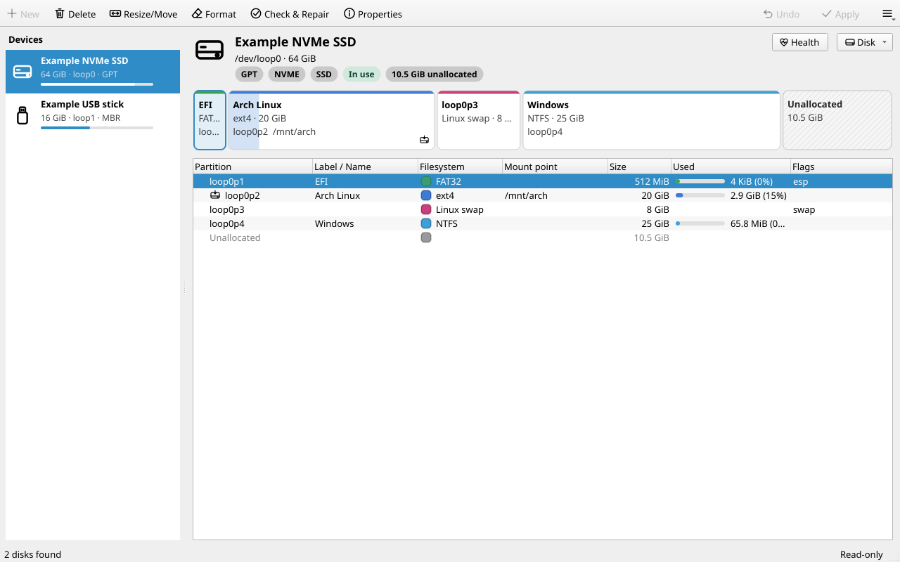
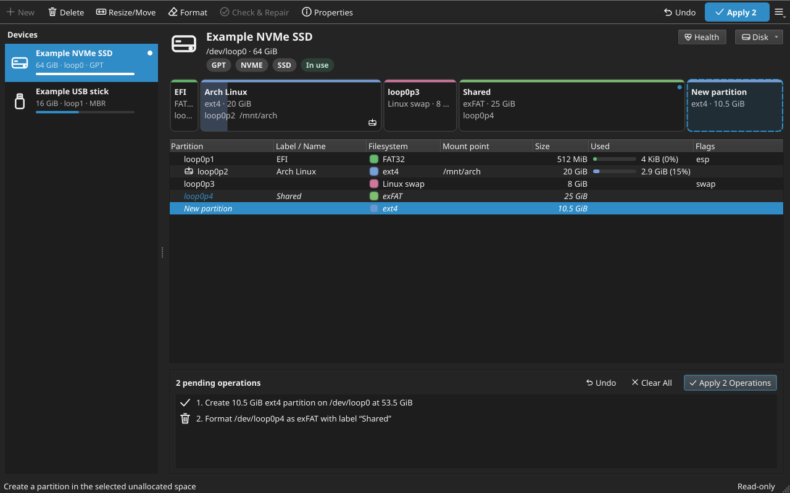
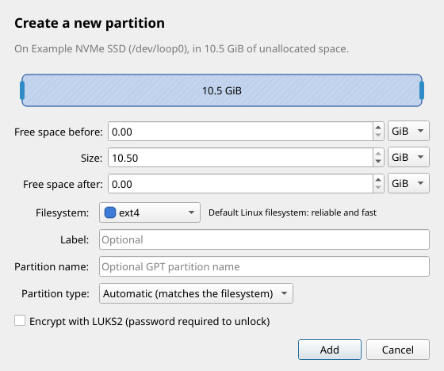
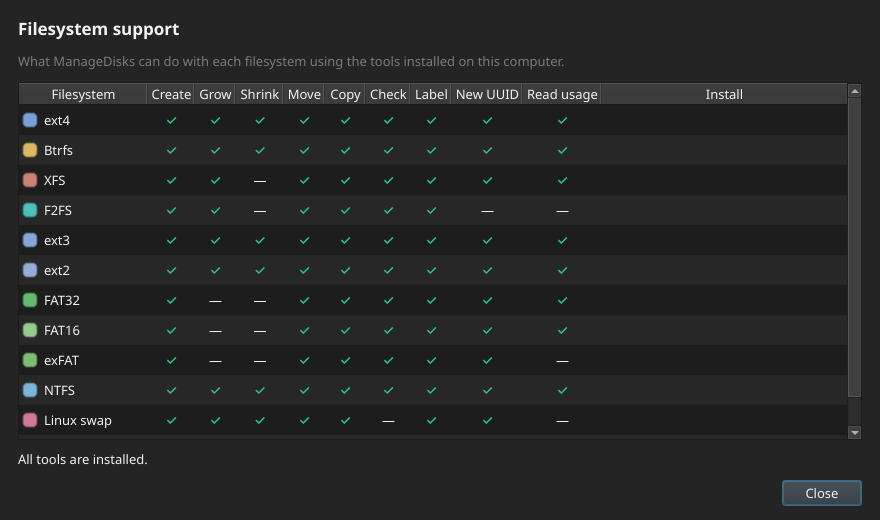

# ManageDisks

A modern, fast disk and partition manager for Linux. It does what **Windows
Disk Management + diskpart**, **KDE Partition Manager** and **EaseUS Partition
Master** do, on Arch Linux and every other popular distribution, with a Qt
interface that follows your desktop's theme.



<details>
<summary>More screenshots (dark theme, dialogs)</summary>





</details>

## Features

| | |
|---|---|
| **Visual disk map** | Every disk shown as a proportional bar with usage, labels, mount points and encryption status (like Disk Management / EaseUS). |
| **Safe, queued changes** | Operations are *pending* until you press **Apply**. The map previews the result; undo any step. Everything is re-validated before it runs. |
| **Partitions** | Create, delete, format, **resize, move** (data is moved safely by `sfdisk --move-data`), copy/paste, wipe. Primary/extended/logical on MBR. |
| **Filesystems** | ext2/3/4, Btrfs, XFS, F2FS, FAT16/32, exFAT, NTFS, Linux swap. Grow/shrink where the filesystem allows it, check & repair, labels, new UUIDs. |
| **Encryption** | Create LUKS2 encrypted partitions, unlock/lock them. |
| **Partition tables** | New GPT/MBR table, **convert MBR ⇄ GPT without data loss**, partition type, GPT name and attributes, MBR boot flag. |
| **Disk tools** | S.M.A.R.T. health & self-tests, surface test (bad sectors), **clone disk**, **create/restore images** (write an ISO or `.img.xz` to a USB stick), safely remove. |
| **Mount** | Mount/unmount (via udisks like your file manager, or directly), swap on/off. |
| **Command line** | `managedisks-cli` for scripts, plus `managedisks-cli shell`, an interactive **diskpart-style console** (`list disk`, `select disk 1`, `create partition primary size=20480`, `format fs=ext4 quick`, `extend`, `shrink`, `clean`, `convert gpt`, …). |
| **Follows your theme** | Uses your Qt style/icon theme (Breeze, Adwaita, Kvantum, qt6ct…), switches light/dark with the desktop and uses its accent color. |
| **Secure by design** | The window runs as your user. A small helper does privileged work after a polkit (pkexec) password prompt, and only accepts validated high-level operations. |
| **Tells you what's missing** | *Filesystem Support* shows which features need which package, with the exact install command for your distribution. |

## Install

The quickest way, on **any** supported distribution:

```sh
git clone https://github.com/oreo1298/ManageDisks.git
cd ManageDisks
./install.sh            # asks for your password, installs dependencies + ManageDisks
```

`install.sh` detects Arch/Manjaro/EndeavourOS/CachyOS, Debian/Ubuntu/Mint/Pop!_OS,
Fedora/RHEL clones, openSUSE, Void, Alpine, Gentoo, Solus and Mageia, installs the
dependencies with the native package manager and installs ManageDisks into
`/usr/local`. Options: `--prefix DIR`, `--no-deps`, `--minimal` (skip optional
filesystem tools), `--yes` (non-interactive).

Prefer a real package from your package manager? Use these instead:

| Distribution | Install | Upgrade | Uninstall |
|---|---|---|---|
| **Arch**, Manjaro, EndeavourOS, CachyOS | `cd packaging/arch && makepkg -si` | run `makepkg -si` again | `sudo pacman -Rns managedisks-git` |
| **Debian**, Ubuntu, Mint, Pop!_OS | `make deb && sudo apt install ./managedisks_*_all.deb` | `git pull`, then the same two commands | `sudo apt remove managedisks` |
| **Fedora**, RHEL/Alma/Rocky, openSUSE | `make rpm && sudo dnf install ~/rpmbuild/RPMS/noarch/managedisks-*.rpm` | `git pull`, then the same | `sudo dnf remove managedisks` |
| Anything else | `./install.sh` | `./install.sh upgrade` | `./install.sh uninstall` |

On openSUSE, use `zypper install`/`zypper remove` instead of `dnf`. See
**[docs/INSTALL.md](docs/INSTALL.md)** for per-distribution details, NixOS,
running from source, and troubleshooting.

### Upgrade

```sh
cd ManageDisks
./install.sh upgrade     # git pull + reinstall (keeps your install prefix)
```

### Uninstall

```sh
./install.sh uninstall           # remove the program
./install.sh uninstall --purge   # also remove settings and the operations log
```

`./install.sh status` shows the installed version and which filesystem tools are missing.

## Usage

Start **ManageDisks** from your application menu (or run `managedisks`).

1. Pick a disk on the left. The map and table show its partitions and free space.
2. Select a partition or unallocated space and use the toolbar, the right-click
   menu, double-click (free space → new partition, partition → properties) or the
   keyboard (`Ins` new, `Del` delete, `Ctrl+R` resize, `F2` properties,
   `Ctrl+Z` undo, `Ctrl+Enter` apply).
3. Review the **pending operations** at the bottom, then press **Apply**. You are
   asked for your password once; progress and a detailed log are shown.

Disk-wide tools (new partition table, convert MBR/GPT, wipe, health, surface
test, clone, images, safely remove) are in the **Disk** menu.

The window starts in read-only mode and only asks for your password when you
apply changes or press **Unlock**. Unlocking also shows the usage of unmounted
filesystems and exact partition table geometry.

### Command line

```sh
managedisks-cli list                                   # disks, partitions, free space
managedisks-cli support                                # what is supported / missing
sudo managedisks-cli table /dev/sdb gpt                # new partition table
sudo managedisks-cli create /dev/sdb -s 512M -f fat32 -t esp -L EFI
sudo managedisks-cli create /dev/sdb -f ext4 -L data   # rest of the free space
sudo managedisks-cli resize /dev/sdb2 --size=-10G      # shrink by 10 GiB
sudo managedisks-cli resize /dev/sdb2 --size max       # grow into free space
sudo managedisks-cli convert /dev/sdb mbr              # keep data
sudo managedisks-cli image restore archlinux.iso /dev/sdc
sudo managedisks-cli --dry-run format /dev/sdb2 -f btrfs   # show the commands only
```

Interactive, diskpart-style:

```text
$ sudo managedisks-cli shell
MANAGEDISKS> list disk
MANAGEDISKS> select disk 1
MANAGEDISKS> clean
MANAGEDISKS> convert gpt
MANAGEDISKS> create partition efi
MANAGEDISKS> create partition primary size=40960
MANAGEDISKS> format fs=ext4 label="data" quick
MANAGEDISKS> assign
```

Sizes accept `20G`/`20GiB` (binary), `20GB` (decimal), `2048s` (sectors) and
`50%`; a bare number means MiB, as in diskpart.

## How it works

```
 ┌──────────────── your user ────────────────┐     ┌────────── root ──────────┐
 │ Qt GUI (PySide6 or PyQt6)                 │     │ managedisks-helper       │
 │  scan (lsblk/sysfs) · preview · queue ops │────▶│  re-validates the queue  │
 └───────────────────────────────────────────┘ JSON│  runs sfdisk, mkfs.*,    │
                     pkexec (polkit) prompt ───────▶│  resize2fs, ntfsresize,  │
 managedisks-cli (sudo) uses the same engine        │  cryptsetup, smartctl …  │
                                                    └──────────────────────────┘
```

* Partition tables are edited with `sfdisk` (util-linux, present on every
  distribution); the kernel is updated partition-by-partition with `partx`, so
  growing a mounted root partition works.
* Filesystems are handled by their own tools (`e2fsprogs`, `btrfs-progs`,
  `xfsprogs`, `dosfstools`, `exfatprogs`, `ntfs-3g`, `f2fs-tools`, `cryptsetup`).
  Shrinking always shrinks the filesystem *before* the partition; growing grows it
  *after*. NTFS/FAT boot sectors are updated after a move so Windows stays bootable.
* Every applied operation is logged to `/var/log/managedisks/operations.log`.

## Safety notes

* **Back up important data first.** Resizing and moving are safe when nothing
  goes wrong, but a power cut in the middle of a move can destroy the partition.
* Partitions that are mounted can only be grown (ext4, Btrfs, XFS) or shrunk
  (Btrfs) online. Moving needs the partition unmounted. To modify your running
  system partition, boot a live USB.
* Not yet supported: resizing FAT and LUKS volumes, and managing LVM/RAID/ZFS
  (they are shown, but left alone).

## Development

```sh
python3 -m managedisks              # run the GUI from the checkout
python3 -m managedisks.cli list     # run the CLI from the checkout
python3 -m pytest                   # unit tests (integration tests need root + loop devices)
sudo python3 -m pytest tests/test_integration_loop.py   # real partitioning on loop devices
```

The code is split into `managedisks/core` (toolkit-free engine: scanning, model,
operations, execution), `managedisks/helper` (privileged JSON-lines server),
`managedisks/cli` and `managedisks/gui`.

## License

MIT, see [LICENSE](LICENSE).
